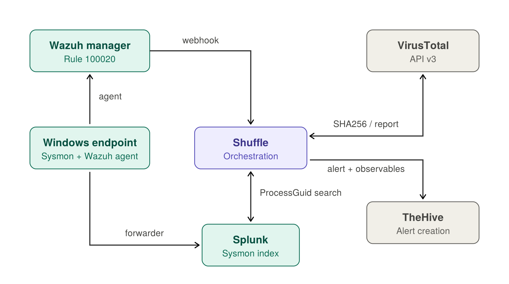
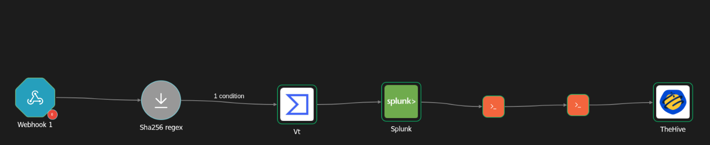

# SOC Automation: Wazuh → Shuffle → VirusTotal → Splunk → TheHive

Automated enrichment and investigation of executables launched from Windows Temp directories. When Wazuh fires, Shuffle checks the file hash against VirusTotal and pulls a process-level activity timeline from Splunk, then opens a populated TheHive alert. The analyst starts with context instead of a raw log line.

## Architecture




| Component  | Role                                                      |
| ---------- | --------------------------------------------------------- |
| Sysmon     | Endpoint telemetry                                        |
| Wazuh      | Detection; forwards matching alerts to Shuffle by webhook |
| Splunk     | Stores full Sysmon history for investigation              |
| Shuffle    | Orchestration and report building                         |
| VirusTotal | File hash reputation                                      |
| TheHive    | Alert and case management                                 |

## Detection Logic

Rule [`100020`](rules/wazuh_rules.xml) (level 10) builds on Wazuh's `sysmon_event1` group and matches when the process image path is an `.exe` under `AppData\Local\Temp` or `Windows\Temp`, including subdirectories. Malware commonly stages and runs from these locations, though legitimate software may also do so.

## Automation Workflow



[`workflows/shuffle_workflow.json`](workflows/shuffle_workflow.json) (replace the `<...REDACTED>` placeholders after import):

1. **Webhook** receives the Wazuh alert.
2. **sha256_regex** extracts the SHA256 from the Sysmon `hashes` field.
3. **VirusTotal** `get_a_hash_report` returns detection stats, file type, reputation and first/last seen.
4. **Splunk** search pulls Sysmon events tied to the alert's `ProcessGuid` ([`splunk/process_investigation.spl`](splunk/process_investigation.spl)).
5. **process_activity_report** builds a Markdown timeline and summary counts.
6. **prepare_thehive_alert** assembles execution details, endpoint, hashes, VT results, timeline, and hash/filename/IP observables.
7. **TheHive** creates the alert.

VirusTotal outcomes are normalized to `completed`, `not_found` or `failed`, so a missing hash or API error is shown in the alert instead of breaking the workflow.

## Process-Centric Investigation

Correlation uses Sysmon's `ProcessGuid`, which is unique per process instance. Matching on PID or image name is unreliable because PIDs get reused and names repeat.

| Sysmon event | Activity | Matched on |
|---|---|---|
| 1 | Child process created | `ParentProcessGuid` = alerting `ProcessGuid` |
| 3 | Network connection | `ProcessGuid` |
| 11 | File created | `ProcessGuid` |
| 13 | Registry modified | `ProcessGuid` |
| 22 | DNS query | `ProcessGuid` |

## Evidence

- Wazuh alert (rule 100020 firing): raw payload in [`samples/alert-sample.json`](samples/alert-sample.json)
- Shuffle workflow: [shuffle-workflow-canvas](screenshots/shuffle-workflow-canvas.png)
- TheHive alert:
  - [Overview and execution details](screenshots/thehive-alert-1.png)
  - [VirusTotal analysis](screenshots/thehive-alert-2.png)
  - [Correlated process activity](screenshots/thehive-alert-3.png)


## Testing and Validation

Tested in a lab VM (Windows with Sysmon, the Wazuh agent and the Splunk Universal Forwarder).

- `curl.exe` copied to `C:\Windows\Temp` and launched from PowerShell: rule 100020 fired, and the alert carries the parent process, command line and hashes (see [`samples/alert-sample.json`](samples/alert-sample.json)).

To replay an alert without the VM:

```bash
curl -X POST "$SHUFFLE_WEBHOOK_URL" \
  -H "Content-Type: application/json" \
  -d @samples/shuffle-payload.json
```

VirusTotal and TheHive steps will work with the replayed alert; the Splunk timeline only fills in if the alert's ProcessGuid exists in your index.

## Limitations

- Detects only `.exe` in two Temp paths. Scripts, DLLs, and other staging locations (`Downloads`, `ProgramData`, `Users\Public`) are not covered.
- No allowlist, so installers and updaters that legitimately run from Temp will alert.
- Only first-level children of the alerting process are collected; deeper process trees are not followed.
- Events may not have arrived in Splunk at query time. An empty timeline is inconclusive; re-run the search after the expected ingestion delay before concluding no activity occurred.
